# RootFix · Do Oracle ao MongoDB

**Global Solution 2026/2 · CitizenTech · Mastering Relational and Non-Relational Database**
Grupo **Rooted**

| Integrante | RM | Turma |
|---|---|---|
| Raul Rezende | RM564002 | 2TSDPF |
| Felipe Furlanetto | RM562766 | 2TSDPF |
| João Victor Caetano | RM562074 | 2TSDPF |
| Ryan Vetoriano | RM565667 | 2TSDPF |
| João Victor Bueno | RM564115 | 2TSDPF |

---

## 1. O problema

Buracos, postes apagados, bueiros entupidos e lixo acumulado levam semanas para chegar a quem pode resolver. Quando chegam, o morador não sabe se alguém está cuidando do problema.

O **RootFix** é uma plataforma de zeladoria urbana colaborativa, organizada por comunidade:

- **Gestores** (associações de moradores, conselhos comunitários, secretarias) criam comunidades de bairro.
- **Moradores** entram nas comunidades a até **3 km** do endereço deles e publicam problemas com foto e localização.
- **Vizinhos** apoiam os problemas ("também sofri com isso") e deixam observações.
- **O gestor** adota os problemas que vai acompanhar e muda o status deles: PENDENTE → EM_ANDAMENTO → RESOLVIDO, ou ARQUIVADO.

O benefício para o cidadão é ver o que está acontecendo no próprio bairro e quem está cuidando de cada problema. A solução se relaciona com a ODS 11 (cidades e comunidades sustentáveis).

Nesta disciplina, as regras de negócio do RootFix foram implementadas no **Oracle com PL/SQL**, e parte dos mesmos dados foi representada no **MongoDB**. A transição entre os dois bancos é demonstrada por scripts e pela comparação dos resultados.

---

## 2. Estrutura do repositório

```
RootFix_db/
├── README.md                        este documento
├── INTEGRANTES.txt                  identificação do grupo
├── oracle/
│   ├── RootFix-script-bd.sql        DDL: 12 tabelas, restrições e categorias
│   ├── 01-objetos-plsql.sql         auditoria, funções, procedimentos, gatilhos e pacotes
│   ├── 02-carga-dados-teste.sql     bloco anônimo com laços: dados de teste
│   ├── 03-relatorio-comunidades.sql bloco anônimo com cursores: relatório
│   ├── 04-testes-plsql.sql          30 testes dos objetos PL/SQL
│   ├── 05-consultas-comparacao.sql  as 3 consultas do MongoDB em SQL
│   └── LEIA-ME.md                   detalhes dos scripts Oracle
├── mongodb/
│   ├── 01-criar-e-carregar.js       use, createCollection, insertMany
│   ├── 02-consultas.js              find e aggregate (3 relatórios)
│   └── PASSO-A-PASSO.md             guia de execução do MongoDB
└── docs/                            prints de evidência
```

---

## 3. Como executar

### Oracle (SQL Developer, sempre com F5, "Executar script")

Antes, abra **Exibir → Saída do DBMS**, clique no **+** e escolha a conexão. Sem isso, as mensagens do 02, do 03 e do 04 não aparecem.

| Ordem | Script | Resultado esperado |
|---|---|---|
| 0 | `oracle/RootFix-script-bd.sql` | 12 tabelas `RF_*` criadas |
| 1 | `oracle/01-objetos-plsql.sql` | 10 objetos com status `VALID` |
| 2 | `oracle/02-carga-dados-teste.sql` | "Carga de teste concluída." |
| 3 | `oracle/03-relatorio-comunidades.sql` | Relatório por comunidade |
| 4 | `oracle/04-testes-plsql.sql` | "Resultado: 30 OK, 0 falha(s)" |
| 5 | `oracle/05-consultas-comparacao.sql` | 3 relatórios e a conferência |

Todos podem ser rodados de novo, com uma exceção: o DDL recria as tabelas e apaga os dados. Depois dele, rode o 01 e o 02 outra vez.

### MongoDB (mongosh, no MongoDB Compass ou no Atlas)

1. Copie o arquivo `mongodb/01-criar-e-carregar.js` inteiro e cole no mongosh. A conferência do final tem que mostrar 3 comunidades e 10 problemas.
2. Copie o arquivo `mongodb/02-consultas.js` inteiro e cole no mongosh. Ele roda os 3 relatórios.

O passo a passo completo está em [`mongodb/PASSO-A-PASSO.md`](mongodb/PASSO-A-PASSO.md).

---

## 4. Modelo Oracle

São 12 tabelas, compartilhadas com as APIs Java e .NET do RootFix, mais a tabela de auditoria criada pelo PL/SQL.

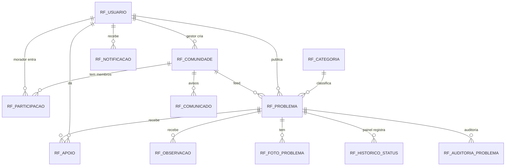

| Tabela | Para que serve |
|---|---|
| `RF_USUARIO` | Moradores e gestores, com perfil, endereço e coordenadas |
| `RF_COMUNIDADE` | Comunidade de bairro criada por um gestor |
| `RF_PARTICIPACAO` | Liga morador e comunidade (N:N, sem repetir o par) |
| `RF_CATEGORIA` | Tipos de problema (buraco, iluminação, lixo...) |
| `RF_PROBLEMA` | Problema publicado; depois da adoção, ganha status |
| `RF_FOTO_PROBLEMA` | Fotos em BLOB |
| `RF_APOIO` | Apoio de um morador a um problema (1 por pessoa) |
| `RF_OBSERVACAO` | Comentários dos vizinhos |
| `RF_COMUNICADO` | Aviso oficial do gestor |
| `RF_HISTORICO_STATUS` | Mudanças de status feitas pelo painel do gestor |
| `RF_NOTIFICACAO` | Avisos para os moradores |
| `RF_IDEMPOTENCIA` | Controle técnico da API .NET |
| `RF_AUDITORIA_PROBLEMA` | Trilha de auditoria de `RF_PROBLEMA` (criada pelo PL/SQL) |

As restrições do banco garantem estas regras:
- e-mail único por usuário;
- um apoio por pessoa por problema;
- uma participação por pessoa por comunidade;
- status só com valores válidos;
- problema adotado sempre com status e data de adoção.

---

## 5. PL/SQL: regras de negócio

| Requisito do PDF | Objeto | Regra real do RootFix |
|---|---|---|
| 2 blocos com decisão, repetição ou cursor | Bloco do `02-carga-dados-teste.sql` | Laços `FOR` e `IF`: cadastra os dados e só põe o morador nas comunidades a até 3 km |
| | Bloco do `03-relatorio-comunidades.sql` | Cursor explícito (`OPEN`/`FETCH`/`CLOSE`) e cursor com parâmetro: relatório por comunidade |
| 2 funções | `FN_DISTANCIA_KM` | Distância entre dois pontos (fórmula de Haversine), base da regra dos 3 km |
| | `FN_TOTAL_APOIOS` | Total de apoios de um problema, para o ranking do gestor |
| 2 procedimentos | `PRC_ADOTAR_PROBLEMA` | Só o gestor da comunidade adota; o problema adotado começa em PENDENTE |
| | `PRC_ALTERAR_STATUS` | Valida a transição: PENDENTE → EM_ANDAMENTO → RESOLVIDO, ou ARQUIVADO; RESOLVIDO e ARQUIVADO são finais |
| 2 gatilhos, 1 de auditoria | `TRG_RF_PROBLEMA_AUDITORIA` | Grava data, operação (INSERT/UPDATE/DELETE), valor antigo e valor novo em `RF_AUDITORIA_PROBLEMA` |
| | `TRG_RF_PROBLEMA_ADOCAO` | Ao adotar, preenche a data de adoção e o status inicial quando vierem vazios |
| 2 pacotes (spec + body) com testes | `PKG_COMUNIDADE` | Distância, raio de 3 km, total de membros e comunidades próximas (`SYS_REFCURSOR`) |
| | `PKG_PROBLEMA` | Apoios, adoção, status, contagem por status e ranking dos mais apoiados |
| | `04-testes-plsql.sql` | 30 testes, incluindo os casos de erro, com ROLLBACK no fim |

Os erros de regra de negócio usam `RAISE_APPLICATION_ERROR`:

| Código | Quando |
|---|---|
| -20001 | Problema não encontrado |
| -20002 | Quem tenta adotar ou mudar o status não é o gestor da comunidade |
| -20003 | Problema já adotado |
| -20004 | Problema ainda não adotado |
| -20005 | Status inválido |
| -20006 | Mudança de status não permitida |
| -20008 | Usuário ou comunidade não encontrado |

**Dados de teste:**
- 2 gestores, 3 comunidades, 7 moradores, 10 problemas, 14 apoios, 5 observações e 3 comunicados, em bairros reais de São Paulo;
- um morador mora em Santo Amaro, longe de todas as comunidades, para testar a regra dos 3 km;
- os usuários de teste usam e-mail `@teste.rootfix.com` e a senha `Rootfix@2026`.

### Evidências Oracle

**Todos os objetos compilados (`VALID`)**
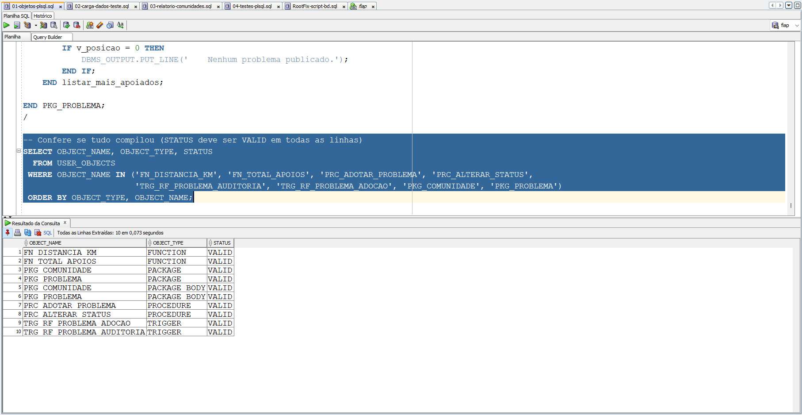

**Carga de dados com laços (02)**
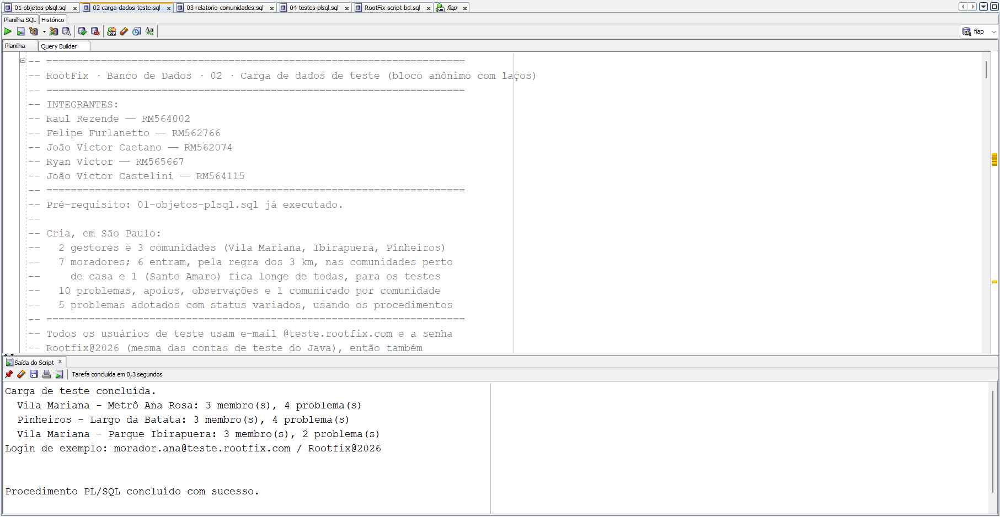

**Relatório com cursores (03)**
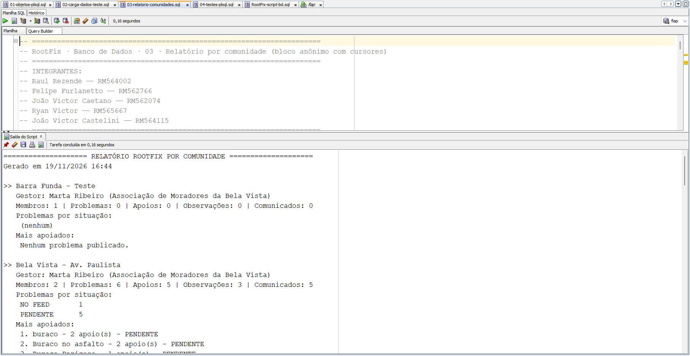

**Testes das funções, procedimentos, gatilhos e pacotes (04)**
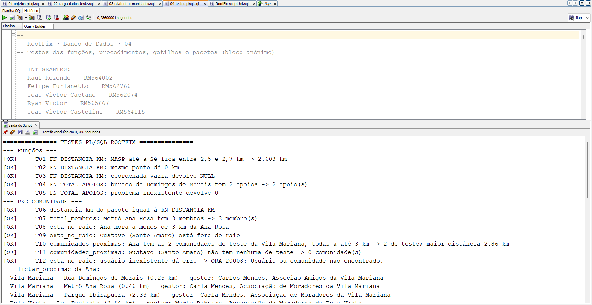
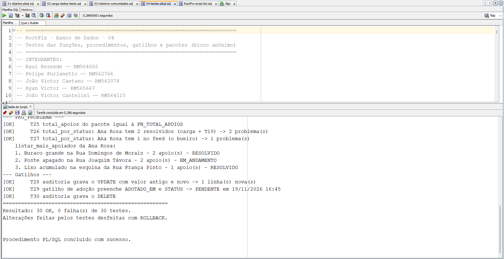

**Trilha de auditoria: operação, data, valor antigo e valor novo**
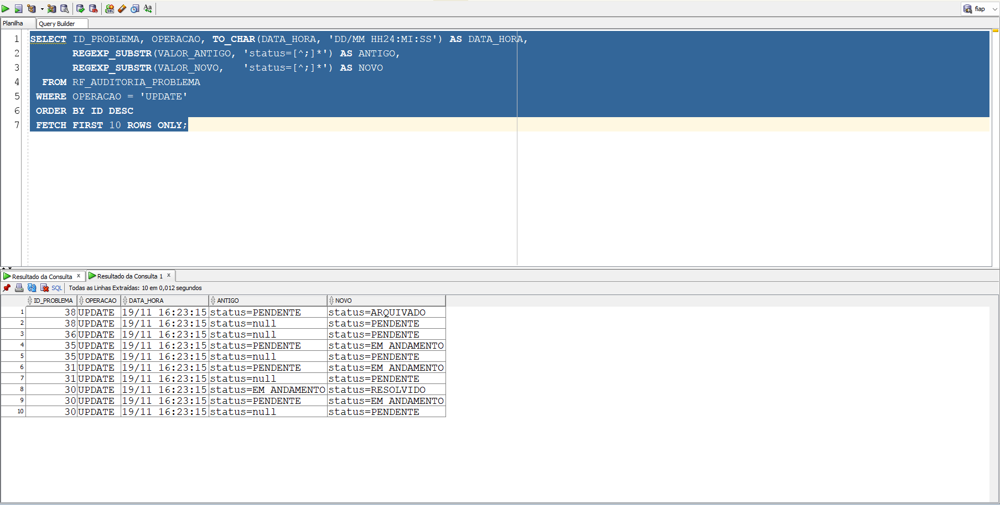

---

## 6. MongoDB

O database é o `rootfix`, com 2 collections e 13 documentos: 3 em `comunidades` e 10 em `problemas`. Os documentos representam os mesmos registros da carga de teste do Oracle.

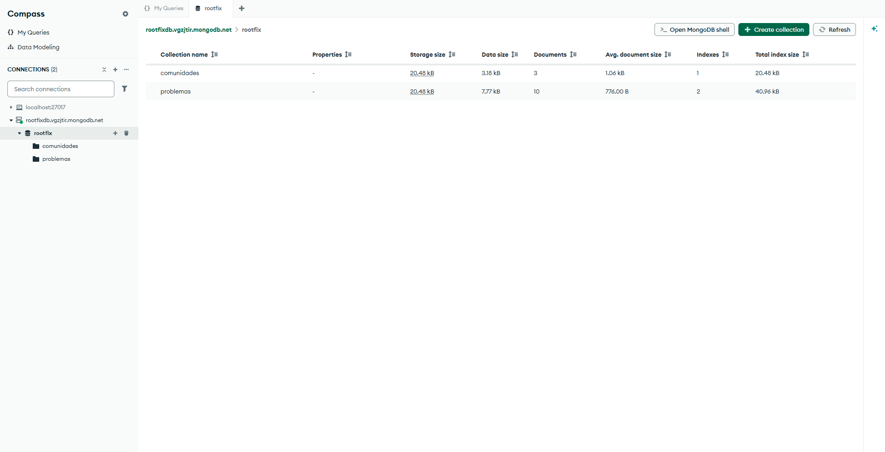

### Exemplo de documento em `problemas`

```json
{
  "titulo": "Buraco grande na Rua Domingos de Morais",
  "comunidade": { "_id": "vila-mariana-ana-rosa", "nome": "Vila Mariana - Metrô Ana Rosa" },
  "autor": { "nome": "Ana Lima", "email": "morador.ana@teste.rootfix.com" },
  "categoria": "Buraco ou pavimento",
  "gravidadeIa": "ALTA",
  "localizacao": { "type": "Point", "coordinates": [-46.6352, -23.5838] },
  "adotado": true,
  "status": "RESOLVIDO",
  "apoios": ["morador.bruno@teste.rootfix.com", "morador.camila@teste.rootfix.com"],
  "totalApoios": 2,
  "observacoes": [
    { "autor": { "nome": "Camila Rocha", "email": "morador.camila@teste.rootfix.com" },
      "texto": "Ontem um motoqueiro quase caiu aí." }
  ]
}
```

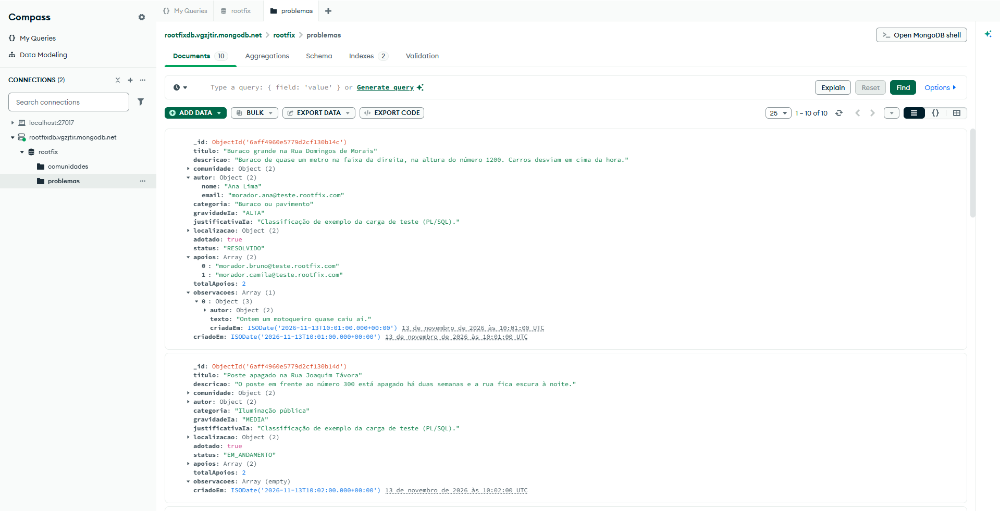
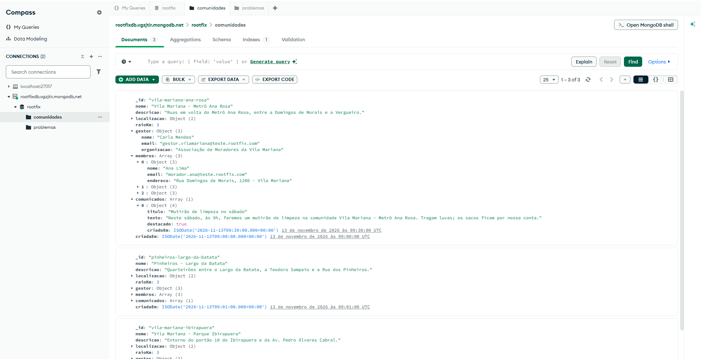

### 6.1 Mapa relacional → documental

| Oracle | MongoDB | Escolha | Por quê |
|---|---|---|---|
| `RF_COMUNIDADE` | collection `comunidades` | Documento principal | É a unidade que o app abre: nome, área e gestor |
| `RF_USUARIO` (gestor) | `comunidades.gestor` | **Incorporado** | Sempre aparece junto da comunidade e muda pouco |
| `RF_PARTICIPACAO` + `RF_USUARIO` | `comunidades.membros[]` | **Incorporado** (array) | Uma comunidade de bairro tem poucos membros, e eles são lidos junto com ela |
| `RF_COMUNICADO` | `comunidades.comunicados[]` | **Incorporado** (array) | Poucos avisos por comunidade, sempre exibidos no topo dela |
| `RF_PROBLEMA` | collection `problemas` | Documento principal | É o que mais cresce e o mais consultado (feed, ranking, painel) |
| `RF_PROBLEMA.ID_COMUNIDADE` | `problemas.comunidade` (`_id` + `nome`) | **Referenciado**, com o nome copiado | Uma comunidade pode ter muitos problemas. Incorporar todos deixaria o documento da comunidade grande demais. O nome copiado evita uma segunda busca só para mostrar o nome no feed |
| `RF_USUARIO` (autor) | `problemas.autor` | **Incorporado** (nome e e-mail) | O feed sempre mostra quem publicou |
| `RF_CATEGORIA` | `problemas.categoria` | **Incorporado** (só o nome) | Lista pequena e fixa; no documento só importa o nome |
| `RF_APOIO` | `problemas.apoios[]` + `totalApoios` | **Incorporado** | O voto é sempre lido junto com o problema. O total guardado deixa o ranking direto |
| `RF_OBSERVACAO` | `problemas.observacoes[]` | **Incorporado** | Os comentários aparecem sempre na tela do problema |
| `RF_FOTO_PROBLEMA` | não migrado | — | A foto é binária (BLOB) e fica no Oracle; no Mongo entrariam só os metadados |
| `RF_HISTORICO_STATUS`, `RF_NOTIFICACAO`, `RF_IDEMPOTENCIA` | não migrados | — | São controles das APIs, fora do escopo da representação documental |

**Resumo da transição:** no Oracle, um feed precisa juntar `RF_PROBLEMA`, `RF_USUARIO`, `RF_CATEGORIA`, `RF_APOIO` e `RF_OBSERVACAO`. No MongoDB, cada problema já traz tudo o que a tela mostra, e o feed vira uma única leitura na collection `problemas`. O custo é a duplicação de alguns dados, como o nome do autor e o nome da comunidade, que precisariam ser atualizados nos documentos se mudassem.

### 6.2 Correspondência Oracle ↔ MongoDB

A ligação entre os registros é feita pelas chaves que são únicas no Oracle:
- **comunidade:** pelo `NOME`;
- **pessoa:** pelo `EMAIL`, que é `UNIQUE` em `RF_USUARIO`;
- **problema:** pelo `TITULO`.

A conferência dos dois lados mostra os mesmos totais:

| | Comunidades | Problemas | Apoios | Observações | Membros | Comunicados |
|---|---|---|---|---|---|---|
| **Oracle** | 3 | 10 | 14 | 5 | 9 | 3 |
| **MongoDB** | 3 | 10 | 14 | 5 | 9 | 3 |

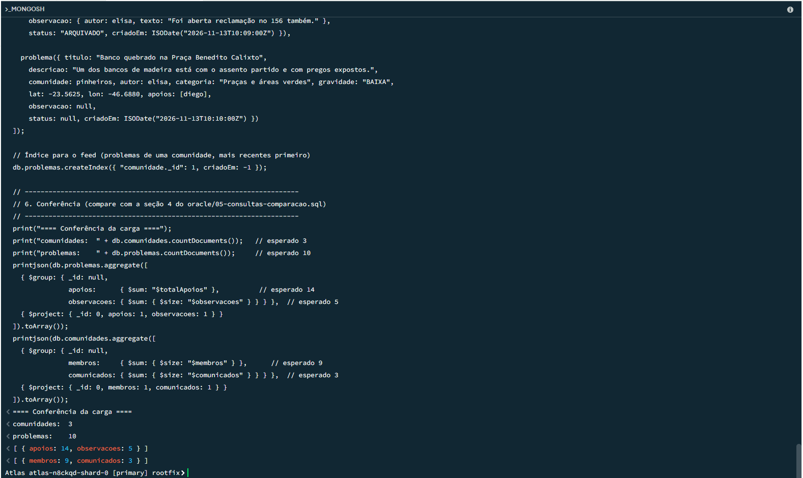
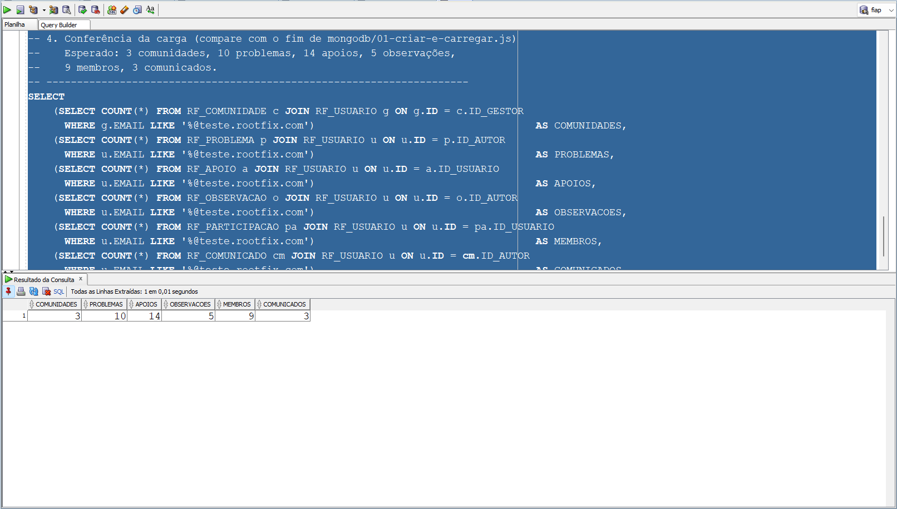

---

## 7. Relatórios: MongoDB x Oracle

As consultas estão em `mongodb/02-consultas.js` e em `oracle/05-consultas-comparacao.sql`.

### Relatório 1: feed de uma comunidade

Problemas da "Vila Mariana - Metrô Ana Rosa", do mais recente para o mais antigo.

```javascript
db.problemas.find(
  { "comunidade._id": "vila-mariana-ana-rosa" },
  { _id: 0, titulo: 1, situacao: { $ifNull: ["$status", "NO FEED"] }, totalApoios: 1 }
).sort({ criadoEm: -1 })
```
```sql
SELECT p.TITULO, NVL(p.STATUS, 'NO FEED') AS SITUACAO,
       (SELECT COUNT(*) FROM RF_APOIO a WHERE a.ID_PROBLEMA = p.ID) AS TOTAL_APOIOS
  FROM RF_PROBLEMA p JOIN RF_COMUNIDADE c ON c.ID = p.ID_COMUNIDADE
 WHERE c.NOME = 'Vila Mariana - Metrô Ana Rosa'
 ORDER BY p.CRIADO_EM DESC;
```

| Título | Situação | Apoios |
|---|---|---|
| Bueiro entupido na Rua Vergueiro | NO FEED | 0 |
| Lixo acumulado na esquina da Rua França Pinto | NO FEED | 1 |
| Poste apagado na Rua Joaquim Távora | EM_ANDAMENTO | 2 |
| Buraco grande na Rua Domingos de Morais | RESOLVIDO | 2 |

"NO FEED" é o problema que ainda não foi adotado pelo gestor.

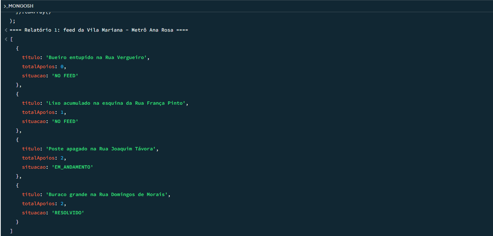
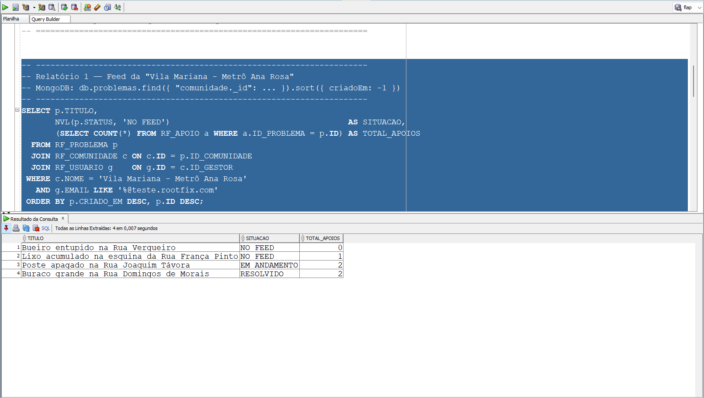

**Resultado: igual nos dois bancos (4 linhas).**

### Relatório 2: mais apoiados ainda não adotados

Ajuda o gestor a decidir o que adotar.

```javascript
db.problemas.find(
  { adotado: false },
  { _id: 0, titulo: 1, comunidade: "$comunidade.nome", totalApoios: 1 }
).sort({ totalApoios: -1, titulo: 1 }).limit(5)
```
```sql
SELECT p.TITULO, c.NOME AS COMUNIDADE, COUNT(a.ID) AS TOTAL_APOIOS
  FROM RF_PROBLEMA p JOIN RF_COMUNIDADE c ON c.ID = p.ID_COMUNIDADE
  LEFT JOIN RF_APOIO a ON a.ID_PROBLEMA = p.ID
 WHERE p.ADOTADO = 0
 GROUP BY p.ID, p.TITULO, c.NOME
 ORDER BY TOTAL_APOIOS DESC, p.TITULO
 FETCH FIRST 5 ROWS ONLY;
```

| Título | Comunidade | Apoios |
|---|---|---|
| Banco quebrado na Praça Benedito Calixto | Pinheiros - Largo da Batata | 1 |
| Calçada quebrada perto do portão 10 do Ibirapuera | Vila Mariana - Parque Ibirapuera | 1 |
| Entulho abandonado no Largo da Batata | Pinheiros - Largo da Batata | 1 |
| Lixo acumulado na esquina da Rua França Pinto | Vila Mariana - Metrô Ana Rosa | 1 |
| Bueiro entupido na Rua Vergueiro | Vila Mariana - Metrô Ana Rosa | 0 |

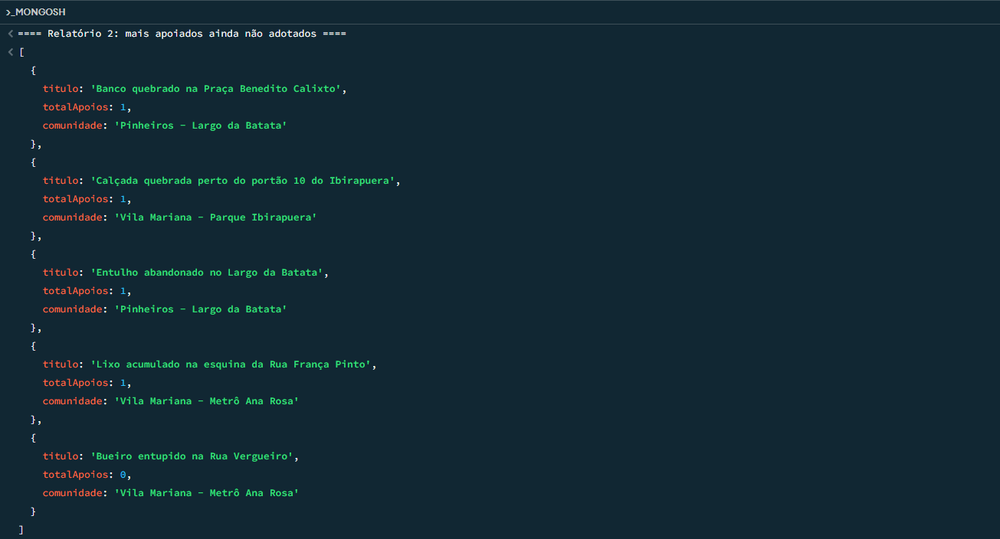
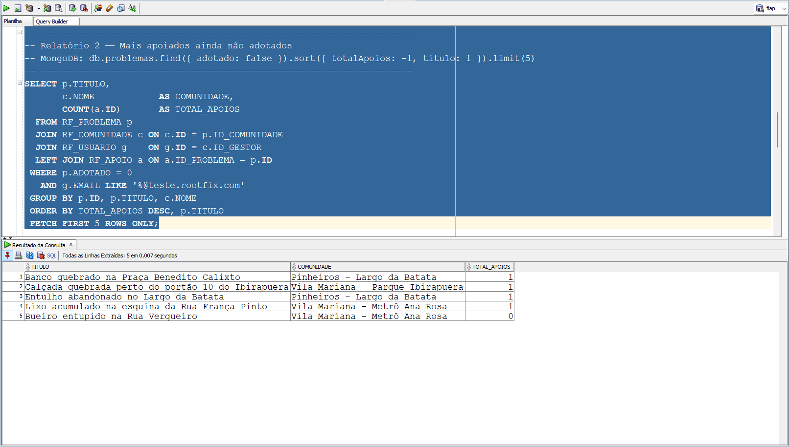

**Resultado: igual nos dois bancos (5 linhas).**

### Relatório 3: problemas por comunidade e situação (agregação)

```javascript
db.problemas.aggregate([
  { $group: { _id: { comunidade: "$comunidade.nome", situacao: { $ifNull: ["$status", "NO FEED"] } },
              problemas: { $sum: 1 }, apoios: { $sum: "$totalApoios" } } },
  { $project: { _id: 0, comunidade: "$_id.comunidade", situacao: "$_id.situacao", problemas: 1, apoios: 1 } },
  { $sort: { comunidade: 1, situacao: 1 } }
])
```
```sql
SELECT c.NOME AS COMUNIDADE, NVL(p.STATUS, 'NO FEED') AS SITUACAO,
       COUNT(DISTINCT p.ID) AS PROBLEMAS, COUNT(a.ID) AS APOIOS
  FROM RF_PROBLEMA p JOIN RF_COMUNIDADE c ON c.ID = p.ID_COMUNIDADE
  LEFT JOIN RF_APOIO a ON a.ID_PROBLEMA = p.ID
 GROUP BY c.NOME, NVL(p.STATUS, 'NO FEED')
 ORDER BY COMUNIDADE, SITUACAO;
```

| Comunidade | Situação | Problemas | Apoios |
|---|---|---|---|
| Pinheiros - Largo da Batata | ARQUIVADO | 1 | 2 |
| Pinheiros - Largo da Batata | NO FEED | 2 | 2 |
| Pinheiros - Largo da Batata | PENDENTE | 1 | 2 |
| Vila Mariana - Metrô Ana Rosa | EM_ANDAMENTO | 1 | 2 |
| Vila Mariana - Metrô Ana Rosa | NO FEED | 2 | 1 |
| Vila Mariana - Metrô Ana Rosa | RESOLVIDO | 1 | 2 |
| Vila Mariana - Parque Ibirapuera | EM_ANDAMENTO | 1 | 2 |
| Vila Mariana - Parque Ibirapuera | NO FEED | 1 | 1 |

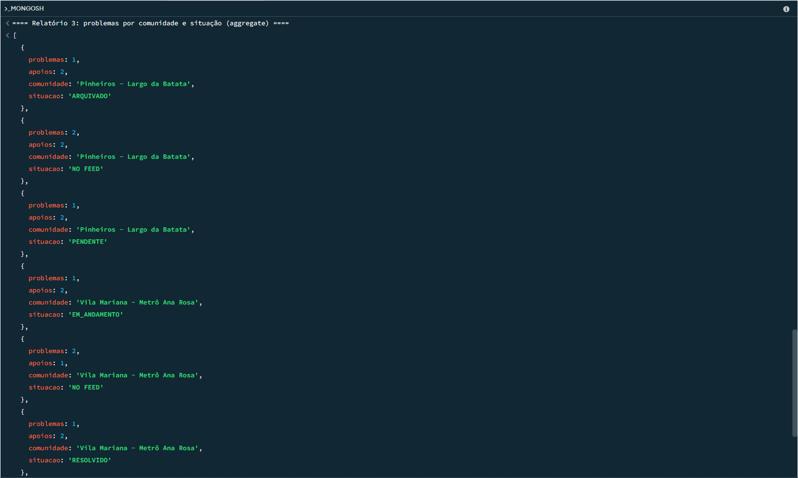
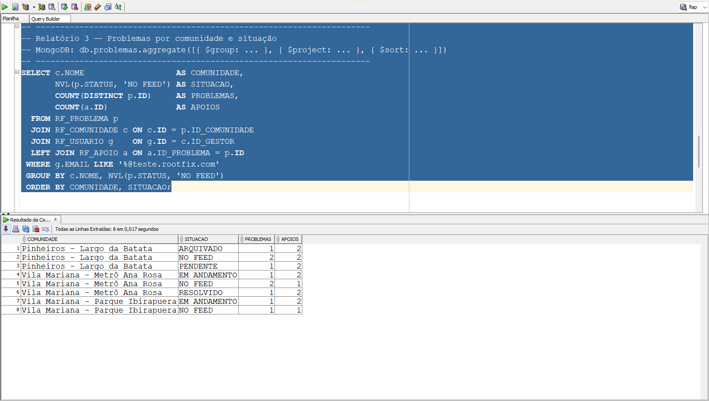

**Resultado: igual nos dois bancos (8 linhas).**

Nas consultas do Oracle, o filtro `g.EMAIL LIKE '%@teste.rootfix.com'` (no arquivo completo) limita o resultado às comunidades da carga de teste. Assim a comparação usa exatamente os mesmos registros que foram para o MongoDB, mesmo que o app tenha criado outras comunidades no banco.

---

## 8. Requisitos do PDF x entrega

| # | Requisito | Pts | Onde está |
|---|---|---|---|
| 01 | Modelo Oracle (2+ tabelas relacionadas), dados de teste e 2 blocos PL/SQL | 10 | `RootFix-script-bd.sql`, `02` e `03` · seções 4 e 5 |
| 02 | 2 funções e 2 procedimentos | 15 | `01-objetos-plsql.sql` · seção 5 |
| 03 | 2 gatilhos e trilha de auditoria | 10 | `01-objetos-plsql.sql` · seção 5 e print da auditoria |
| 04 | 2 pacotes (spec + body) e testes | 10 | `01-objetos-plsql.sql` e `04-testes-plsql.sql` |
| 05 | MongoDB: database, 2 collections e 10+ documentos | 10 | `mongodb/01-criar-e-carregar.js` · seção 6 |
| 06 | Mapa relacional → documental, 3 consultas (1 agregação) e comparação | 15 | `mongodb/02-consultas.js`, `oracle/05-consultas-comparacao.sql` · seções 6.1, 6.2 e 7 |

---

## 9. Declaração de uso de IA generativa

O grupo usou o **Claude (Anthropic)** como apoio:
- para rascunhar e revisar os scripts PL/SQL e MongoDB;
- para alinhar o modelo de dados com as APIs Java e .NET;
- para montar o guia de execução e este README.

Todos os scripts foram revisados e executados pelo grupo no Oracle da FIAP e no MongoDB Atlas, e as evidências acima são dessas execuções. As decisões de regra de negócio e de modelagem são do grupo.
